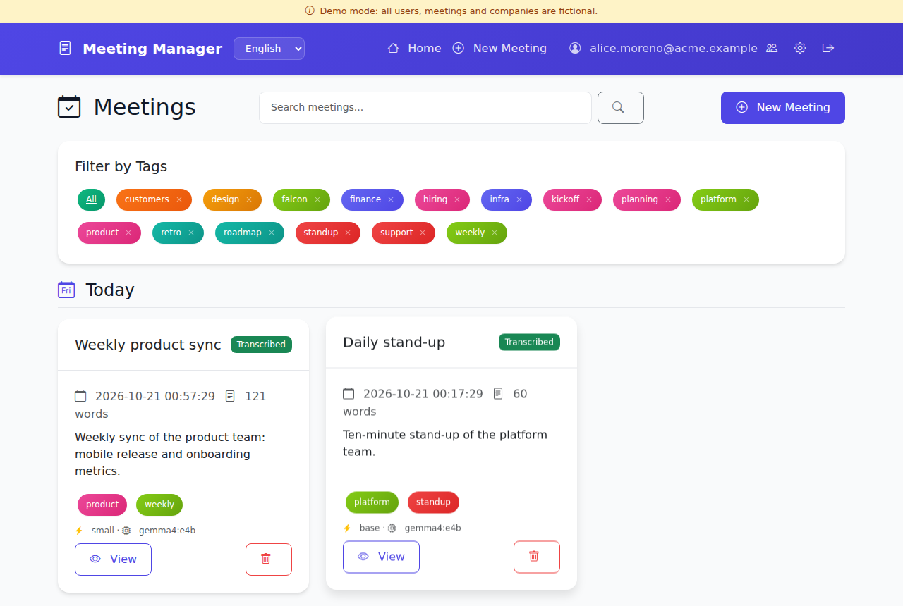
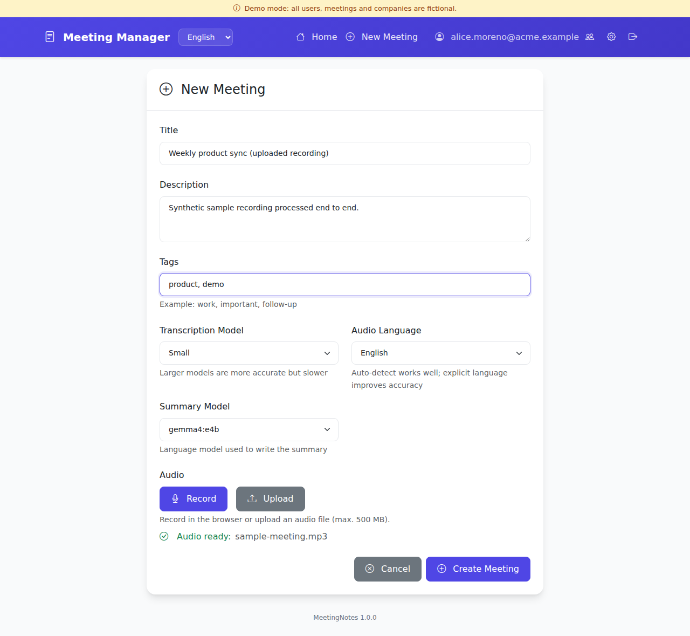
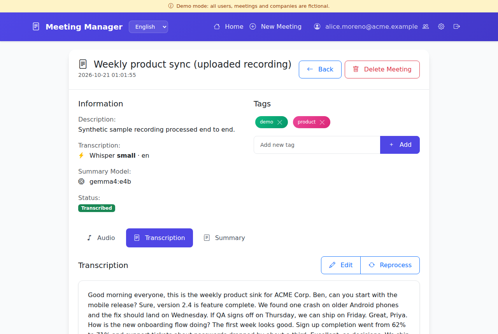
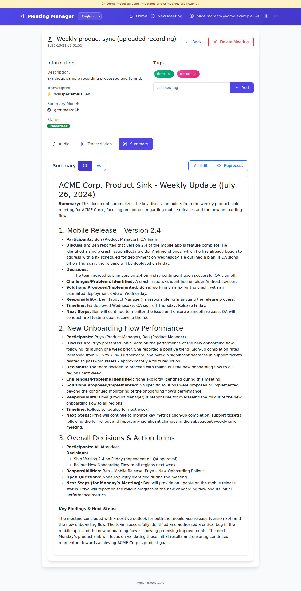
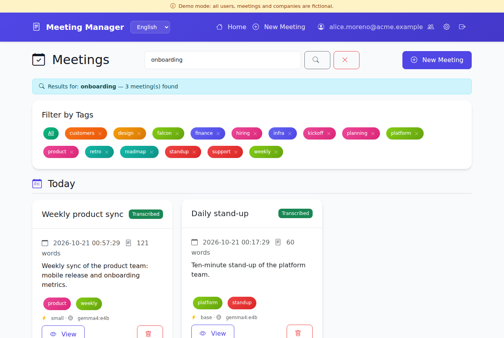
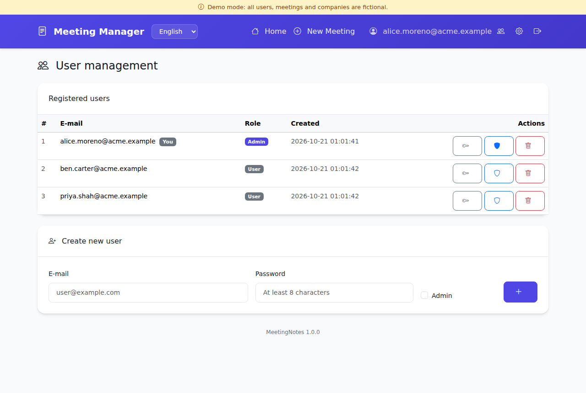
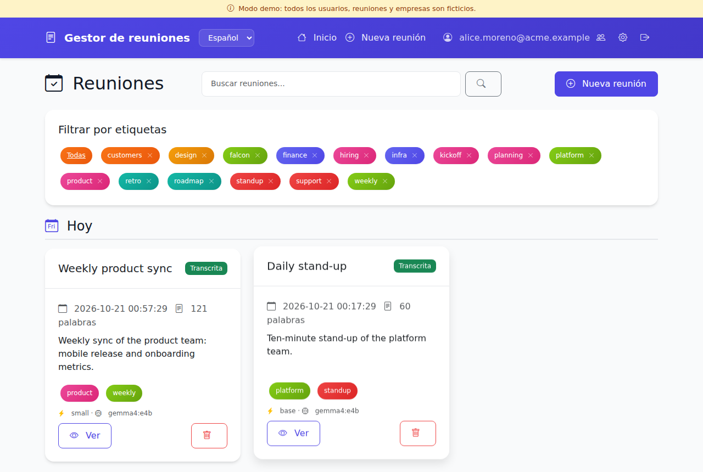
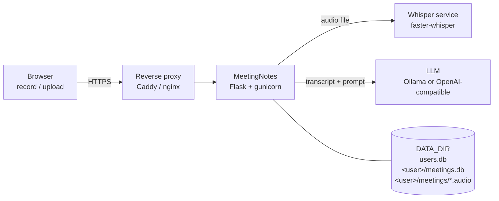

# MeetingNotes

**Record or upload a meeting, get a transcript and a structured summary, all on your own hardware.**

MeetingNotes is a small self-hosted web app. You record a meeting in the browser (or upload
an audio file), it is transcribed with [Whisper](https://github.com/openai/whisper) through
[faster-whisper](https://github.com/SYSTRAN/faster-whisper), and a local language model
served by [Ollama](https://ollama.com) (or any OpenAI-compatible API) writes a summary
with topics, decisions, owners and next steps, in English and Spanish. Meetings can
be tagged, searched, edited and reprocessed with other models.

It is a single Flask app with SQLite storage and a separate speech-to-text service,
packaged with Docker Compose. A **demo mode** seeds fictional users and meetings so you
can try it without recording anything.



*All screenshots come from demo mode. "Acme Corp" and every person in them are fictional,
and the sample recording was produced with a text-to-speech voice.*

## Features

- **Record or upload.** Record in the browser (WebM/Ogg/MP4 via MediaRecorder) or upload
  MP3, WAV, M4A, OGG, FLAC or WebM. Browser recordings are converted to WAV with ffmpeg
  before transcription.
- **Transcription with Whisper.** Choose the model per meeting (tiny to large-v3) and the
  audio language, or let Whisper detect it. 12 languages are listed in the UI; Whisper
  supports many more.
- **Summaries by a local LLM.** Summaries are generated in English and Spanish (configurable),
  structured by topic with decisions, problems, owners, deadlines and next steps. Pick any
  model your Ollama server has, and regenerate with a different one at any time.
- **Background processing.** Uploads return immediately; transcription and summaries run in
  the background, and the meeting page updates itself when they are done. Interrupted jobs
  are reset on restart.
- **Edit everything.** Transcripts and summaries can be edited in the browser (Markdown).
  Reprocess a transcript with a bigger model, or a summary with another LLM.
- **Organise and find.** Tags (filter by tag, remove a tag everywhere), full-text search
  across titles, descriptions, transcripts and summaries, and a timeline grouped by
  today / yesterday / this week / last week / this month / older.
- **Multi-user.** Each user has a private SQLite database and audio folder. Admins create
  users, reset passwords and grant the admin role; users change their own password.
  Optional single sign-on through an authenticating reverse proxy.
- **Bilingual UI.** English and Spanish (Flask-Babel), switchable from the navigation bar.
- **Self-contained.** No external CDNs, fonts or analytics: Bootstrap and its icons are
  served by the app itself.

| Upload a recording | Transcript |
|---|---|
|  |  |

| Summary | Search |
|---|---|
|  |  |

| User management | Spanish UI |
|---|---|
|  |  |

More: [login](docs/screenshots/01-login.png), [processing](docs/screenshots/05-processing.png),
[profile](docs/screenshots/09-profile.png), [summary in Spanish](docs/screenshots/11-summary-es.png).

The transcript and summary shown above were produced live by the pipeline from the
synthetic sample recording in `demo/` (Whisper `small`, summary by a 4B-parameter model
running in Ollama).

## Architecture



```
browser ──► reverse proxy (TLS) ──► app :5002 ──► whisper :9000  (POST /transcribe)
                                        │    └──► ollama :11434  (POST /api/generate)
                                        └── /data  (SQLite + audio, one folder per user)
```

- `app.py`: the web app (routes, auth, background jobs, Whisper and LLM clients).
- `whisper_server.py`: a ~90-line FastAPI wrapper around faster-whisper. Any service that
  accepts `POST multipart file (+ model, language)` and returns `{"text": "..."}` works.
- `demo.py`: demo data and offline fallbacks.
- Storage: `DATA_DIR/users.db` holds accounts; each user gets `DATA_DIR/<id>/meetings.db`
  and `DATA_DIR/<id>/meetings/<meeting-id>/<audio>`.

## Quick start

### Try the demo (no models needed)

```bash
git clone https://github.com/mmiretta/meetingnotes.git
cd meetingnotes
DEMO_MODE=1 docker compose up -d --build
```

Open <http://127.0.0.1:5002> and sign in as `alice.moreno@acme.example` with password
`demo`. If no Whisper or LLM service is reachable, demo mode answers new uploads with a
canned transcript and summary so you can see the whole flow. Demo mode only seeds an
**empty** data volume; remove it with `docker compose down -v`.

### Run it for real (everything in Docker)

```bash
cp .env.example .env
# edit .env: set SECRET_KEY, ADMIN_EMAIL and ADMIN_PASSWORD at least
docker compose --profile whisper --profile ollama up -d --build
docker compose exec ollama ollama pull llama3.2:3b     # or any model you like
```

With an NVIDIA GPU, add the GPU override (see [docs/DEPLOY.md](docs/DEPLOY.md)):

```bash
docker compose -f docker-compose.yml -f docker-compose.gpu.yml \
    --profile whisper --profile ollama up -d --build
```

Already running Whisper or Ollama elsewhere? Start only the app and point it there:

```bash
WHISPER_URL=http://host.docker.internal:9000/transcribe \
OLLAMA_URL=http://host.docker.internal:11434 \
docker compose up -d --build
```

The app listens on `127.0.0.1:5002` by default. Put a TLS reverse proxy in front of it
before exposing it to a network: [docs/DEPLOY.md](docs/DEPLOY.md) has Caddy and nginx examples.

### Without Docker

```bash
python3 -m venv .venv && . .venv/bin/activate
pip install -r requirements.txt
pybabel compile -d translations
DATA_DIR=./data DEMO_MODE=1 python app.py          # http://127.0.0.1:5002
```

ffmpeg must be installed to process browser recordings. The Whisper service needs
`pip install -r requirements-whisper.txt` and `python whisper_server.py`.

### Creating users

Set `ADMIN_EMAIL` and `ADMIN_PASSWORD` before the first start, or create users from the
command line at any time:

```bash
docker compose exec app flask --app app create-user alice@example.com --admin
```

After that, admins manage users from the web UI (people icon in the navigation bar).

## Configuration

Everything is configured with environment variables. With Docker Compose, put them in `.env`
(see [.env.example](.env.example)).

| Variable | Default | Description |
|---|---|---|
| `SECRET_KEY` | *(generated)* | Signs session cookies. If empty, a random key is created and kept in `DATA_DIR/.secret_key`. |
| `ADMIN_EMAIL`, `ADMIN_PASSWORD` | | First admin account, created when there are no users yet. |
| `BIND_ADDRESS` | `127.0.0.1` | Host address the container port is published on (Compose). |
| `PORT` | `5002` | Port the app listens on / is published on. |
| `DATA_DIR` | `/data` (Docker), `./data` | Databases and audio files. |
| `DEFAULT_LANGUAGE` | `en` | UI language when the browser does not prefer a supported one (`en`, `es`). |
| `MAX_UPLOAD_MB` | `500` | Maximum upload size. |
| `SESSION_COOKIE_SECURE` | `0` | Set to `1` when served over HTTPS. |
| `DEMO_MODE` | `0` | Seed fictional data into an empty `DATA_DIR` and use canned results when models are unreachable. |
| `DEMO_PASSWORD` | `demo` | Password of the demo users. |
| `WHISPER_URL` | `http://whisper:9000/transcribe` | Speech-to-text endpoint. |
| `WHISPER_DEFAULT_MODEL` | `base` | Default Whisper model in the UI; also the model the Whisper service preloads. |
| `WHISPER_DEVICE` | `cpu` | Whisper service device: `cpu`, `cuda` or `auto`. |
| `WHISPER_COMPUTE_TYPE` | `int8` | faster-whisper compute type (`int8`, `int8_float16`, `float16`...). |
| `WHISPER_TIMEOUT` | `3600` | Seconds to wait for a transcription. |
| `LLM_PROVIDER` | `ollama` | `ollama`, or `openai` for any OpenAI-compatible API. |
| `OLLAMA_URL` | `http://ollama:11434` | Ollama server. |
| `OPENAI_BASE_URL` | | Base URL of an OpenAI-compatible API, e.g. `http://localhost:8000/v1`. |
| `OPENAI_API_KEY` | | API key for that API, if it needs one. |
| `SUMMARY_MODEL` | `llama3.2:3b` | Default summary model. |
| `SUMMARY_LANGUAGES` | `en,es` | Languages every summary is generated in. |
| `LLM_TIMEOUT` | `900` | Seconds to wait for one summary. |
| `LLM_TEMPERATURE` | `0.7` | Sampling temperature. |
| `JOB_CONCURRENCY` | `1` | Transcription/summary jobs allowed to run at once. |
| `TRUSTED_AUTH_HEADER` | | Header with the user's e-mail set by an authenticating proxy (e.g. `X-Auth-Request-Email`). Empty disables it. |
| `TRUSTED_PROXY_CIDRS` | `127.0.0.1/32` | Networks allowed to send `TRUSTED_AUTH_HEADER`. |
| `SSL_CERT_FILE`, `SSL_KEY_FILE` | | Serve HTTPS directly from gunicorn (a reverse proxy is recommended instead). |
| `THREADS` | `8` | gunicorn threads. |
| `LOG_LEVEL` | `INFO` | Python log level. |

## Models and hardware

**Speech-to-text.** faster-whisper runs the OpenAI Whisper models converted to CTranslate2.
Order-of-magnitude processing times for one hour of audio (they vary a lot with the
CPU/GPU, beam size and audio quality):

| Model | Size | CPU (8 cores, int8) | GPU (8 GB, int8_float16) | Notes |
|---|---|---|---|---|
| `tiny` / `base` | 75–145 MB | ~5–15 min | < 1 min | Fine for clear audio in English |
| `small` | 480 MB | ~20–30 min | ~1–2 min | Good default for most languages |
| `medium` | 1.5 GB | ~1 h | ~3–4 min | Noticeably better for Spanish and accents |
| `large-v3` | 3 GB | several hours | ~5–8 min | Best quality; use a GPU |

Models are downloaded on first use into the `whisper-models` volume. Whisper does not
identify speakers (no diarization), so transcripts are a single block of text.

**Summaries.** Any instruction-following model works. Small models (3–4B parameters such as
`llama3.2:3b`, `gemma3:4b`, `qwen2.5:3b`) run on a laptop CPU or a 6–8 GB GPU and give good
summaries of short meetings. For long meetings, prefer a model with a large context window
(the whole transcript is sent in one prompt) and raise Ollama's context size
(`OLLAMA_CONTEXT_LENGTH`, or a Modelfile with `num_ctx`). As a rule of thumb, one hour of
speech is 8–10k words, about 12–15k tokens.

## Privacy and security

- **Your audio never leaves your servers** when you use the bundled Whisper and Ollama
  services. If you point `LLM_PROVIDER=openai` at a hosted API, transcripts are sent to that
  provider.
- Recordings, transcripts and summaries are stored **unencrypted** in `DATA_DIR`. Protect the
  volume and its backups like any other confidential data, and tell participants that the
  meeting is being recorded.
- Passwords are hashed with Werkzeug (scrypt/PBKDF2). Sessions are signed cookies
  (`HttpOnly`, `SameSite=Lax`, `Secure` with `SESSION_COOKIE_SECURE=1`). All state-changing
  requests carry a CSRF token. Markdown is rendered with raw HTML escaped.
- There is no built-in rate limiting of sign-in attempts and no TLS of its own: run it behind a
  reverse proxy that terminates TLS (and, ideally, an SSO layer), as described in
  [docs/DEPLOY.md](docs/DEPLOY.md). The Whisper and Ollama services have no authentication and
  are only reachable on the internal Compose network; do not publish their ports.
- `TRUSTED_AUTH_HEADER` must only be enabled when the app is reachable **exclusively** through
  the proxy that sets that header.
- Deleting a user removes the account but keeps their files in `DATA_DIR/<id>/` until an
  operator deletes them.

Found a security problem? Please open a private security advisory on GitHub rather than a
public issue.

## Documentation

- [docs/DEPLOY.md](docs/DEPLOY.md): Docker Compose, GPU, reverse proxy with TLS, backups, upgrades.
- [CONTRIBUTING.md](CONTRIBUTING.md): development setup and translations.
- [CHANGELOG.md](CHANGELOG.md)

## License

[MIT](LICENSE) © 2026 Mariano Miretta.

Bundled third-party assets: [Bootstrap](https://getbootstrap.com) and
[Bootstrap Icons](https://icons.getbootstrap.com) (MIT). The demo recording was synthesised
with the [Kokoro](https://huggingface.co/hexgrad/Kokoro-82M) text-to-speech model (Apache-2.0).
